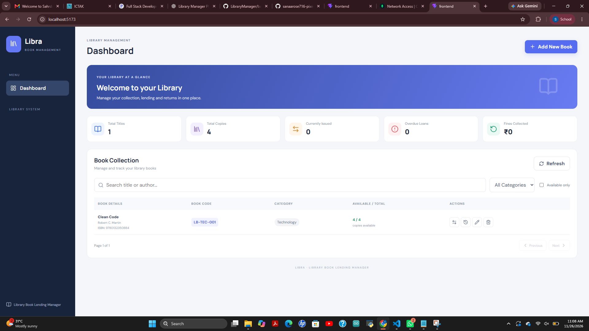
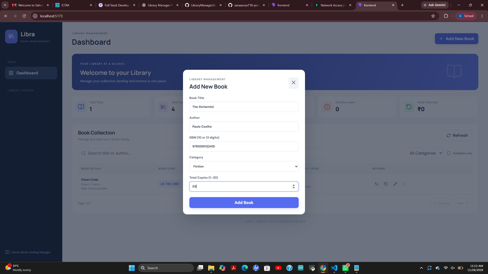
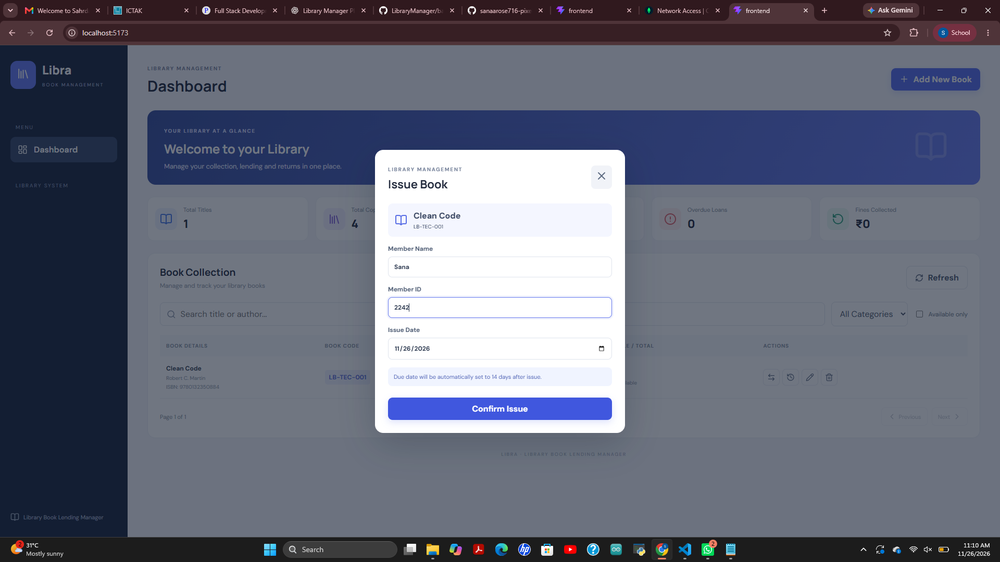
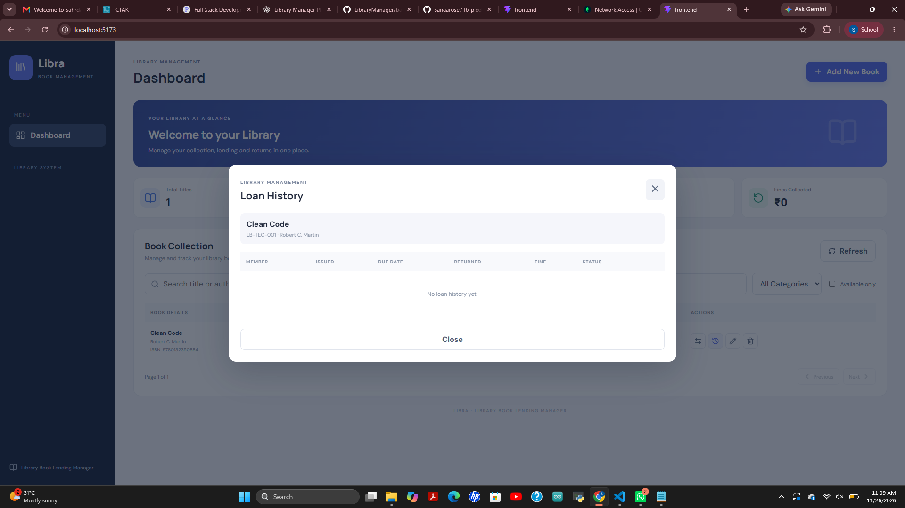
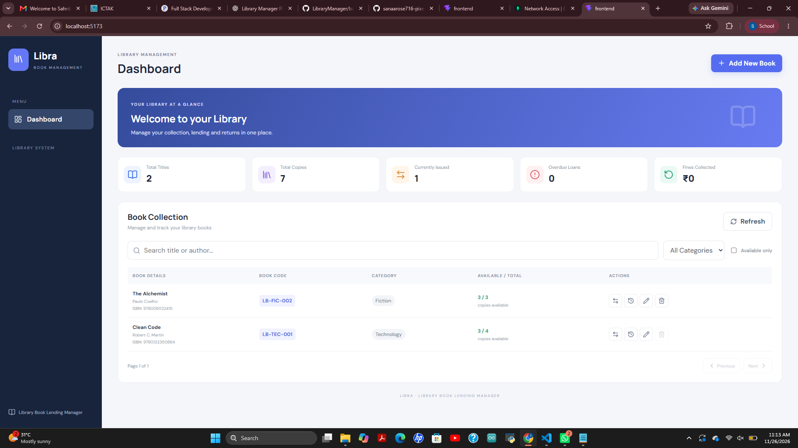

# Library Book Lending Manager

A full-stack Library Book Lending Management System developed using the MERN Stack (MongoDB, Express.js, React.js and Node.js).

## Features

- Add, edit and delete books.
- Automatic book code generation.
- ISBN validation and duplicate ISBN prevention.
- Issue books to library members.
- Return books with automatic fine calculation.
- Automatic due date calculation (14 days).
- Track loan history and overdue books.
- Search books by title and author.
- Filter books by category and availability.
- Pagination (5 books per page).
- Dashboard statistics:
  - Total titles
  - Total copies
  - Currently issued books
  - Overdue books
  - Total fines collected

## Technologies Used

**Frontend**
- React.js
- Axios
- CSS
- Lucide React

**Backend**
- Node.js
- Express.js
- MongoDB
- Mongoose

## Project Structure

```text
LibraryManager/
│
├── backend/
│   ├── server.js
│   ├── package.json
│   └── .env
│
├── frontend/
│   ├── src/
│   │   ├── App.jsx
│   │   ├── App.css
│   │   ├── index.css
│   │   └── main.jsx
│   ├── package.json
│   └── index.html
│
├── .gitignore
└── README.md
```

## Installation and Setup

### 1. Clone the repository

```bash
git clone https://github.com/sanaarose716-pixel/LibraryManager.git
cd LibraryManager
```

### 2. Backend Setup

```bash
cd backend
npm install
```

Configure the `.env` file with your MongoDB connection details.

```env
PORT=5000
MONGO_URI=your_mongodb_connection_string
```

Start the backend:

```bash
npm run dev
```

### 3. Frontend Setup

Open another terminal:

```bash
cd frontend
npm install
npm install axios lucide-react
npm run dev
```

Open http://localhost:5173 in your browser.

## API Endpoints

| Method | Endpoint | Description |
|---|---|---|
| GET | /api/books | Get all books |
| GET | /api/books/:id | Get book details and loan history |
| POST | /api/books | Add a new book |
| PUT | /api/books/:id | Update book details |
| DELETE | /api/books/:id | Delete a book |
| POST | /api/loans/issue | Issue a book |
| PUT | /api/loans/return/:id | Return a book |
| GET | /api/stats | Get dashboard statistics |

## Business Rules

- ISBN must contain exactly 10 or 13 digits.
- Duplicate ISBN entries are not allowed.
- Each book receives an automatically generated book code.
- Due date is calculated as 14 days after issue date.
- Fine is calculated at ₹5 per overdue day.
- Books with active loans cannot be deleted.
- Available copies are maintained by the backend.

## Author

Developed as part of the Full Stack Development (MERN Stack) Exit Examination.

## Screenshots

### Dashboard


### Add Book


### Issue Book


### Book History


### Updated Dashboard


## Technologies Used

- React.js
- Node.js
- Express.js
- MongoDB
- Mongoose
- Axios

## API Base URL

http://localhost:5000/api

## Project Status

Library Book Lending Manager project completed with book management, issue and return operations, loan history, search, filters and dashboard statistics.